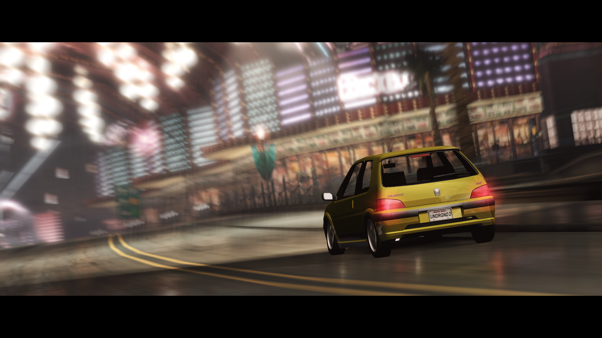
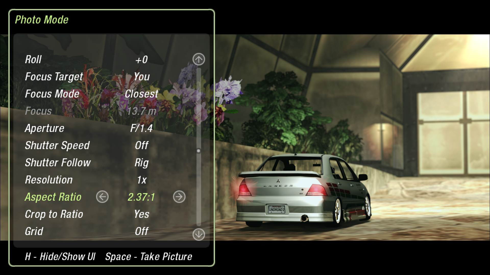

# Photo Mode

A full-fledged photo mode mod for Need For Speed: Underground 2.  

<p>
  
  
</p>

Features:

* Motion blur
* Depth of field
* x1/x2 Resolution
* Watermarks
* Rule of thirds grid
* Different aspect ratios
* Controller support  

And much more!

## Building

You need Visual Studio 2022 or its free Build Tools, with C++ and the Windows SDK installed.

1. Download the code together with the shared library it uses:
   ```
   git clone --recursive https://github.com/le-shark/nfsu2-photomode.git
   ```
2. In that folder, run this in PowerShell:
   ```
   .\build.ps1
   ```
3. The mod is built as `build\RelWithDebInfo\bin\NFSU2PhotoMode.asi`. Copy it and `NFSU2PhotoMode.ini` into the game's `scripts` folder.

## License

MIT, see `LICENSE`. It also includes MinHook (BSD 2-Clause license) and stb_image_write (public domain).
